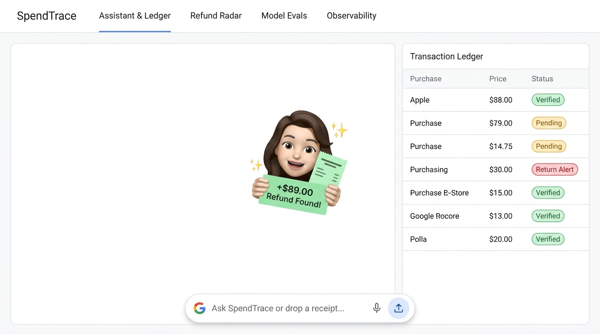

# SpendTrace — AI Expense and Purchase Intelligence Agent

> **"Never lose money to forgotten returns or mystery charges again."**

[](https://srp-alohamora.github.io/SpendTrace/)
[](https://srp-alohamora.github.io/SpendTrace/submission.docx)
[](https://github.com/SRP-alohamora/SpendTrace)

* **🌐 Live Web Application (GitHub Pages):** [https://srp-alohamora.github.io/SpendTrace/](https://srp-alohamora.github.io/SpendTrace/)
* **📄 Download Official Submission Document:** [submission.docx](file:///Users/shivanipradhan/GithubProjects/SpendTrace/submission.docx) ([GitHub Pages Direct Download](https://srp-alohamora.github.io/SpendTrace/submission.docx))
* **📦 GitHub Repository:** [https://github.com/SRP-alohamora/SpendTrace](https://github.com/SRP-alohamora/SpendTrace)

---

**SpendTrace** is a standalone, web-based application that helps individuals and households record expenses, organize purchase information, and understand spending through natural-language interaction. Users can describe an expense in a message, upload receipts, and import supported historical transaction or order files. The application converts these inputs into structured records stored in a persistent database.

The project addresses the fragmentation of purchase information across receipts, emails, merchant accounts, and financial statements. Its AI agent connects related records, identifies potential duplicates, reconciles refunds, and asks users to clarify uncertain information. Planned extensions include receipt forwarding, authorized email access, and selected merchant integrations.

Users can ask questions such as *“Why did my spending increase this month?”* or *“Which returns have no matching refund?”* The application calculates results through database queries and provides explanations linked to supporting records. Users can review, correct, export, and delete their information.

The initial prototype includes conversational expense entry, receipt uploads, historical CSV imports, spending visualizations, and source-linked analysis. A public demonstration using fictional data allows visitors to experience expense capture, reconciliation, and historical analysis without sharing personal financial information.

Success is evaluated through extraction accuracy, duplicate detection, refund matching, numerical correctness, and user feedback. The project demonstrates an end-to-end AI product combining a hosted interface, persistent storage, agent tool use, and measurable evaluation.

> **Note on Course Alignment:** Assignment-specific alignment remains unverified because the Week 3 handout was unreadable.

---

## Visual Front Page & UX Design

SpendTrace implements a **pure-white, sparse, Google Workspace / Material 3 interface** prioritizing clarity, generous whitespace, and zero visual clutter.



---

## Key Capabilities & Architecture Pillars

* **Multi-Tenant Supabase Open-Source Auth & IAM:** Compatible with [SRP-alohamora/supabase-opensrc-auth](https://github.com/SRP-alohamora/supabase-opensrc-auth) (GoTrue JWT standard). Distinguishes `admin` and `member` roles, featuring a top-bar user switcher and an IAM elevation barrier.
* **Account Data Isolation for New Users:** Any newly registered user account is scoped to their private user ID with **0 transactions, 0 receipts, and 0 returns**. All newly uploaded receipts (PDFs, images), CSV statements, and conversational expenses are saved persistently into PostgreSQL/SQLite.
* **Public Demonstration with Fictional Data:** An included pre-seeded demo admin account (`admin@spendtrace.ai`) comes loaded with 11 realistic benchmark transactions and return slips, enabling visitors to test refund radar, duplicate detection, and analytics immediately without entering personal data.
* **Grounded Facts & Source-Linked Provenance:** When users query spending trends (*"Why did my spending increase?"* or *"Which returns have no matching refund?"*), the agent computes mathematical answers exclusively via sandboxed SQL database queries. Explanations cite exact transaction primary keys (e.g. `tx_4a1f...`) as clickable provenance chips—**zero hallucinated numbers**.
* **The "Refund Radar":** Consumers routinely return purchases online or in-store but forget to check if the refund actually posts 5–14 days later. SpendTrace tracks return slips and proactively alerts you when a merchant fails to refund your money.
* **Human-in-the-Loop Disambiguation:** Instead of guessing or failing silently, SpendTrace uses LangGraph's `interrupt()` primitive to present 1-click clarification cards for duplicate charges or low-confidence receipt scans.
* **Near-Zero COGS (< $0.02 / user / month):** Powered by tiered routing (Gemini 2.0 Flash for multimodal vision and Groq Llama 3.3 70B for SQL reasoning) with embedded storage, keeping unit operating costs under two cents per household per month.

---

## Target Personas

| Target Persona | Who They Are | Primary Pain Point | How SpendTrace Solves It |
| :--- | :--- | :--- | :--- |
| **1. The Frequent E-Commerce Shopper** *(Primary Core)* | 22–38 yr olds frequently buying apparel and goods online (Amazon, Zara, Nordstrom). | Forgets to verify if returned items actually get credited back to their card 10 days later. | **Refund Radar:** Tracks return slips and flags overdue refunds past 10 days with automated dispute drafts. |
| **2. The Busy Household Manager** | Parents managing family spending across multiple cards, Costco, and grocery stores. | Pockets full of fading paper receipts; hates updating spreadsheets; blindsided by high statements. | **Snap & Drop Ingestion:** Multimodal vision itemizes purchases and pairs receipts with bank statement lines. |
| **3. The Solopreneur / Freelancer** | 1099 contractors mixing business meals and software subscriptions with personal accounts. | Spending 10+ hours hunting for receipts and tax-deductible expense proof at year-end. | **Itemized Provenance:** 100% audit trail linking every transaction to original receipt files with 1-click CSV export. |

---

## A Week in the Life with SpendTrace (How Users Use It)

```
[ Step 1: Snap or Type ] ──► [ Step 2: Agent Reconciles ] ──► [ Step 3: 1-Click Clarification ] ──► [ Step 4: Refund Alert & Insights ]
   Take receipt photo,          Matches receipt to bank         Resolves duplicate charges          Flags uncredited returns,
   or type quick note           statement, extracts items       via simple UI card                  answers spending questions
```

1. **Everyday Ingestion (30 Seconds):** Snap a receipt photo at Trader Joe's. SpendTrace extracts 4 line items, subtotal, tax, and total ($42.18) in under 2 seconds.
2. **Hands-Free Return Tracking:** Drop a Zara return slip for an $89.00 jacket. SpendTrace logs it in `Awaiting Credit`. If no refund appears on your statement after 10 days, SpendTrace fires an alert:  
   *🔴 "Action Required: Return to Zara for $89.00 on Oct 12 has not posted to your Chase card."*
3. **Duplicate Charge Intercept:** Upload a bank statement with two identical $18.50 charges at the same diner. SpendTrace interrupts execution and presents a card:  
   *`"We noticed two $18.50 charges at Joe's Diner on Oct 24. Merge as one, or did you make two purchases?"`* `[Merge as Duplicate] [Keep Both]`
4. **Natural Language Spending Insights:** Ask: *"Why did my dining spending increase this month?"* SpendTrace runs a deterministic SQL query and explains:  
   *"Dining spending increased by $240 (+38%) compared to last month, driven by 3 weekend dinners: Nobu ($145), Osteria ($68), and Blue Ribbon ($48)."* (With clickable links to supporting receipts).

---

## Multi-Agent Architecture

SpendTrace is architected as a **Hierarchical Supervisor Multi-Agent System** using **LangGraph**:

```mermaid
graph TD
    User([User Request / Upload]) --> Supervisor[Supervisor / Orchestrator Agent]
    
    subgraph SubAgents [Specialized Sub-Agents]
        Supervisor -->|Receipts, CSVs, Notes| Agent1[1. Ingestion & Extraction Agent]
        Supervisor -->|Parsed Records| Agent2[2. Reconciliation & Refund Agent]
        Supervisor -->|Conflicts / Low Confidence| Agent3[3. Human Clarification Agent HITL]
        Supervisor -->|Spending Questions / Trends| Agent4[4. Analytics & SQL Query Agent]
    end
    
    Agent1 -->|Structured Pydantic Records| Agent2
    Agent2 -->|Flagged Conflicts| Agent3
    Agent3 -->|User Resolution via interrupt()| DB[(SQLite Ledger)]
    Agent2 -->|Clean Records| DB
    Agent4 <-->|Safe Read-Only SQL| DB
    Agent4 -->|Verifiable Citations| Supervisor
    Supervisor --> User
```

1. **Supervisor / Router Node:** Evaluates payload types (image, CSV, text, question) and coordinates graph routing.
2. **Ingestion & Extraction Agent:** Runs single-pass multimodal vision (Gemini 2.0 Flash) to output typed Pydantic `ExtractionContract` models with itemized lines.
3. **Reconciliation & Anomaly Agent:** Matches receipts to bank charges via fuzzy matching, detects duplicate swipes, and links return slips to refund credits.
4. **Human Clarification Agent (HITL):** Uses LangGraph's `interrupt()` primitive to stage ambiguous data for 1-click user resolution.
5. **Analytics & SQL Query Agent:** Translates questions into sandboxed parameterized SQL (`PRAGMA query_only = ON;`), computes exact aggregates, and returns cited answers.
6. **Telemetry & Evals Engine:** Collects OpenTelemetry-compatible trace spans, latency waterwalls, and token costs for display in dedicated UI tabs.

---

## 4-Tab Workspace Navigation

1. **Tab 1: Assistant & Live Ledger:** Dual-pane view with a conversational console, drag-and-drop dropzone, clean slate hero onboarding card for new users, and an interactive ledger table with slide-over receipt inspector.
2. **Tab 2: Refund Radar:** Dedicated lifecycle board tracking returns from `Logged` $\rightarrow$ `Awaiting Credit` $\rightarrow$ `Reconciled` $\rightarrow$ `Overdue (>10 Days)`.
3. **Tab 3: Model Evals & Quality Suite ᵃᵈᵐⁱⁿ ᵐᵒᵈᵉ:** Built-in benchmarking harness running 70 test cases with real-time progress bars, scorecards (Accuracy, F1, P95 latency), side-by-side ground truth vs predicted JSON diffs, and an IAM elevation guard for standard members.
4. **Tab 4: Agent Observability & Traces ᵃᵈᵐⁱⁿ ᵐᵒᵈᵉ:** Real-time execution waterfall Gantt charts, per-step token and latency metrics, deep prompt/tool inspection drawers, and IAM elevation protection.

---

## Technical Stack & Layer Decisions

| Architectural Layer | Selected Stack | Rationale & COGS Impact |
| :--- | :--- | :--- |
| **Agent Orchestration** | **LangGraph (Python 3.11+)** | Deterministic graph control flow, stateful checkpointers, and native `interrupt()` for HITL. $0 framework cost. |
| **Model Inference** | **Tiered Routing: Gemini 2.0 Flash + Groq Llama 3.3 70B** | Multimodal Flash extracts receipts for ~$0.0003/image (98% cheaper than AWS Textract). Fast open models handle SQL generation. |
| **Backend API** | **FastAPI + Pydantic v2 (Async ASGI)** | Native OpenAPI 3.1 generation, SSE streaming, in-process execution with LangGraph, and sub-10ms overhead. |
| **Auth & Authorization** | **Supabase GoTrue JWT Standard** | Interoperable with [SRP-alohamora/supabase-opensrc-auth](https://github.com/SRP-alohamora/supabase-opensrc-auth). Cryptographic verification with RBAC IAM roles. |
| **Database & Storage** | **PostgreSQL (Supabase RLS) + SQLite (WAL) Dual-Mode** | Enterprise schema in `backend/db/postgres_schema.sql` with Row Level Security. Local zero-config SQLite fallback with `PRAGMA busy_timeout = 30000;`. |
| **Frontend Stack** | **React 18 + Vite + TypeScript (SPA)** | Pure-white Google-style sparse UI (Material 3), sub-second responsiveness, and static $0 hosting. |
| **Agent Interoperability** | **OpenAPI 3.1 & JSON-RPC Tool Contracts** | Exposes standard agent tools (`log_expense`, `query_ledger`, `check_refunds`) for external agent integration. |

---

## Project Documentation & Deliverables

* **[PRD.md](file:///Users/shivanipradhan/GithubProjects/SpendTrace/PRD.md)** — Comprehensive Product Requirements Document.
* **[specification.md](file:///Users/shivanipradhan/GithubProjects/SpendTrace/specification.md)** — Detailed System Architecture, Pydantic Input/Output Contracts, Evals & Observability Specs.
* **[SUBMISSION.md](file:///Users/shivanipradhan/GithubProjects/SpendTrace/SUBMISSION.md)** — Official Week 3 Project Submission Document with the 9-point framework and 5-minute video demo script.

---

## Getting Started

### Prerequisites
* Python 3.11+
* Node.js 18+ & npm
* Google Gemini API Key (`GEMINI_API_KEY`)
* Groq API Key (`GROQ_API_KEY`) or Nebius API Key

### Backend Setup
```bash
# Clone the repository
git clone https://github.com/your-username/SpendTrace.git
cd SpendTrace/backend

# Create virtual environment and install dependencies
python3 -m venv venv
source venv/bin/activate
pip install -r requirements.txt

# Configure environment variables
cp .env.example .env
# Edit .env with your API keys

# Initialize SQLite database
python db/database.py

# Start the FastAPI server
uvicorn app:app --reload --port 8000
```
API Documentation will be available at `http://localhost:8000/docs`.

### Frontend Setup
```bash
cd ../frontend
npm install
npm run dev
```
Open `http://localhost:5173` to access the SpendTrace web application.

### Running Automated Evals
```bash
cd ../backend
python evals/runner.py --suite full
```

---

## License
MIT License. Built for the Mastering Agentic AI Certification (The Gen Academy).
