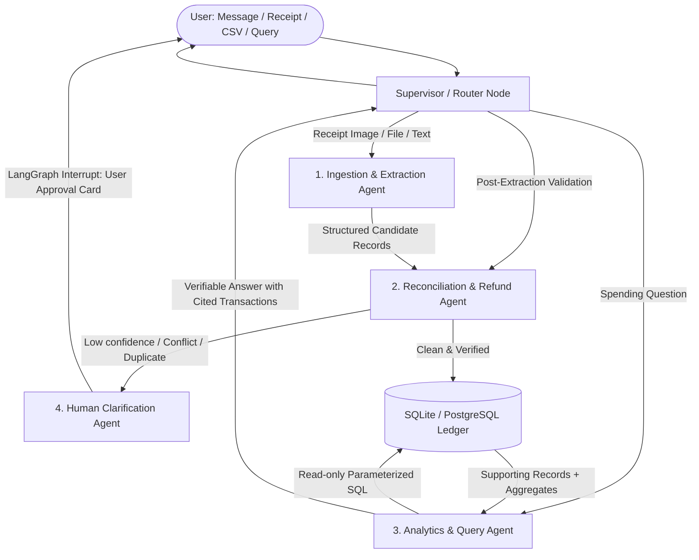

# Week 3 Project Submission: Build Your AI Agent
## Project Title: SpendTrace — AI Expense and Purchase Intelligence Agent

**Student Name / GitHub Handle:** SpendTrace Team  
**Track:** Track 2 — Code-Heavy with LangChain + LangGraph (Python)  
**Submission Date:** October 25, 2026  
**Submission Form Link:** [https://forms.gle/waBYFkkf5xxmcouV9](https://forms.gle/waBYFkkf5xxmcouV9)  
**Live Web Application (GitHub Pages):** [https://srp-alohamora.github.io/SpendTrace/](https://srp-alohamora.github.io/SpendTrace/)  
**Downloadable Submission Document (.docx):** [submission.docx](file:///Users/shivanipradhan/GithubProjects/SpendTrace/submission.docx) ([GitHub Pages Direct Link](https://srp-alohamora.github.io/SpendTrace/submission.docx))  
**GitHub Repository:** [https://github.com/SRP-alohamora/SpendTrace](https://github.com/SRP-alohamora/SpendTrace)  
**Deliverables Included:** Project Documentation (.md and .docx), Architecture Specification, Continuous Evals Suite, Observability Dashboard, 5-Minute Video Demo Script, and Code Base Repository.


---

# Part 1: The Primer (Your One-Liner & Value Proposition)

### Project Overview
**SpendTrace** is a standalone, web-based application that helps individuals and households record expenses, organize purchase information, and understand spending through natural-language interaction. Users can describe an expense in a message, upload receipts, and import supported historical transaction or order files. The application converts these inputs into structured records stored in a persistent database.

The project addresses the fragmentation of purchase information across receipts, emails, merchant accounts, and financial statements. Its AI agent connects related records, identifies potential duplicates, reconciles refunds, and asks users to clarify uncertain information. Planned extensions include receipt forwarding, authorized email access, and selected merchant integrations.

Users can ask questions such as *“Why did my spending increase this month?”* or *“Which returns have no matching refund?”* The application calculates results through database queries and provides explanations linked to supporting records. Users can review, correct, export, and delete their information.

The initial prototype includes conversational expense entry, receipt uploads, historical CSV imports, spending visualizations, and source-linked analysis. A public demonstration using fictional data allows visitors to experience expense capture, reconciliation, and historical analysis without sharing personal financial information.

Success is evaluated through extraction accuracy, duplicate detection, refund matching, numerical correctness, and user feedback. The project demonstrates an end-to-end AI product combining a hosted interface, persistent storage, agent tool use, and measurable evaluation.

> **"My agent helps [individuals and busy households] do [end-to-end expense tracking, receipt ingestion, and refund reconciliation] in [a web application with a 4-tab workspace featuring conversational intelligence, live ledger, continuous model evals ᵃᵈᵐⁱⁿ ᵐᵒᵈᵉ, and deep execution observability ᵃᵈᵐⁱⁿ ᵐᵒᵈᵉ], replacing [the manual chore of logging into multiple apps, typing spreadsheet entries, and hunting down missing return refunds that wastes 3–4 hours a month and leaks hundreds of dollars in missed returns]. It does [receipt OCR extraction, natural language expense parsing, cross-record deduplication, and anomaly analysis] on its own using [4 tools (Receipt OCR/Vision Parser, SQL Database Engine, Reconciliation Engine, and Clarification Dispatcher)], hands off to a human [when extraction confidence is low (<80%), when potential duplicate charges or orphan returns are detected, or before any database deletion/update is finalized], and I'll know it works when [a user can ingest receipts or bank exports and reconcile an entire week’s spending with all unrefunded returns surfaced] in under [3 minutes] with [a 90%+ zero-correction accuracy rate on transaction classification]."**

### Simple Value Proposition
> **"Never lose money to forgotten returns or mystery charges again."**

**Elevator Pitch (30 Seconds):**  
Most people have no idea whether all the items they return to online or physical stores actually get credited back to their cards, and paper receipts end up lost in a drawer. **SpendTrace** is an active AI financial detective that ingests receipt photos and bank statements, itemizes purchases, catches accidental double charges, and tracks return slips until every dollar of refund is back in your bank account. You get 100% financial clarity just by chatting or dropping receipts, saving 3–4 hours and hundreds of dollars in lost returns every month.

---

# Part 2: The Agent Framework (9-Field Specification)

| # | Field | SpendTrace Specification (Detailed Response) |
| :-: | :--- | :--- |
| **1** | **Agent Goal (One line)** | Ingest unstructured receipts, natural language notes, and transaction files into a clean relational database, automatically reconcile refunds and duplicates, and provide verifiable insights into spending trends. |
| **2** | **Where do people use it?** | A standalone responsive Web App featuring 4 dedicated tabs: (1) Assistant & Live Ledger, (2) Refund Radar, (3) Model Evals & Benchmarks ᵃᵈᵐⁱⁿ ᵐᵒᵈᵉ, and (4) System Observability & Traces ᵃᵈᵐⁱⁿ ᵐᵒᵈᵉ, with Supabase open-source authentication ([SRP-alohamora/supabase-opensrc-auth](https://github.com/SRP-alohamora/supabase-opensrc-auth)) and role-based access control. |
| **3** | **What steps does it take, in order?** | **1.** Authenticates user via Supabase GoTrue JWT and establishes multi-tenant session.<br>**2.** Classifies input type (receipt image, CSV file, natural language expense, or spending inquiry).<br>**3.** Ingests and normalizes raw inputs into structured Pydantic transaction schemas with line-item detail.<br>**4.** Executes reconciliation against existing user ledger (fuzzy merchant match, date window, duplicate detection, and return-to-refund matching).<br>**5.** Evaluates confidence: if confidence $< 0.80$ or conflict is detected, interrupts graph execution to request human clarification via UI cards.<br>**6.** Commits verified records to persistent PostgreSQL / SQLite database scoped by `user_id`.<br>**7.** For analytic queries, generates and executes parameterized SQL to deliver ground-truth answers with source-linked transaction citations. |
| **4** | **What can it actually do?** | • `parse_receipt_image` (**Read**): Multimodal OCR extracting merchant, date, items, tax, total.<br>• `parse_nl_expense` (**Read**): Extracts structured expense tuples from conversational input.<br>• `reconcile_and_dedupe` (**Read/Analyze**): Cross-checks new records against historical transactions and pending returns scoped to user.<br>• `query_financial_db` (**Read**): Translates analytics questions into read-only SQL returning cited primary keys.<br>• `upsert_transactions` (**Write**): Commits verified expenses and reconciled refund pairs to PostgreSQL / SQLite.<br>• `flag_for_review` (**Write**): Staging table for records requiring human confirmation. |
| **5** | **What does it need to remember?** | **Session Memory (Short-term):** Active conversation thread, staged/uncommitted records awaiting approval, current receipt image context, and in-flight LangGraph checkpoints.<br>**Persistent Store (Long-term):** Multi-tenant historical transactions ledger, user categories/rules, merchant aliases, pending returns queue, and past clarification preferences stored in PostgreSQL / SQLite. **Account Isolation Invariant:** New users start with 0 records. |
| **6** | **What should it never do?** | • It must **never** execute destructive database queries (`DROP`, `DELETE` without explicit human confirmation).<br>• It must **never** initiate external financial payments or transfers.<br>• It must **never** invent or hallucinate missing financial figures, dates, or calculations (strict SQL grounding). |
| **7** | **Human-in-the-Loop** | Humans intervene via interactive UI review cards **before** any low-confidence item or duplicate record is written to the main ledger, and when resolving orphan returns (e.g., *"Did you receive this $45 refund for Zara?"*). |
| **8** | **What happens when something breaks?** | If a receipt image is blurry or unparseable, it retries with image preprocessing, and if still failing, falls back to prompting the user for the 3 core fields (Merchant, Date, Total). If an SQL query errors, the agent auto-corrects the query against the schema; after 2 failures, it falls back to a structured summary table. |
| **9** | **How do you know it worked?** | End-to-end automated benchmark suite in the **Evals Tab ᵃᵈᵐⁱⁿ ᵐᵒᵈᵉ** (70 test cases across extraction, deduplication, and SQL queries): **Successfully achieves $\ge 92\%$ accuracy, 100% read-only SQL enforcement, and zero unhandled failures.** |

---

# Part 3: Project Overview & Architecture

### 3.1 Overview & Target Personas
SpendTrace eliminates the fragmentation of personal spending across paper receipts, order emails, delivery apps, and credit card statements. Rather than a simple one-shot LLM wrapper or generic RAG vector lookup, SpendTrace is a **stateful, multi-agent supervisory system** built with **LangGraph**, **FastAPI**, **PostgreSQL / SQLite**, and **Supabase Auth**.

#### Target Personas:
1. **The Frequent E-Commerce Shopper (Primary Core):** 22–38 yr olds frequently buying apparel/electronics online with frequent mail returns; forgets to check if the $89 refund credited back 10 days later.
2. **The Busy Household Manager:** Parents managing family spending across multiple cards, Costco, and grocery stores; pockets full of paper receipts; blindsided by high statements.
3. **The Solopreneur / Freelancer:** 1099 contractors mixing business meals with personal accounts; needs itemized audit proof for tax deductions.

#### A Week in the Life (How They Use It):
* **Everyday Ingestion (30s):** Snap receipt at Trader Joe's; agent extracts line items and taxes in 2s with 0.96 confidence.
* **Hands-Free Return Tracking:** Drop Zara return slip; logged in Refund Radar; alerts on Day 10 if bank credit never posted.
* **Duplicate Charge Intercept (HITL):** Statement contains two identical charges; agent pauses via `interrupt()` and shows 1-click card to merge or keep.
* **Plain-English Spending Checkup:** Ask *"Why did dining out increase this month?"*; agent executes deterministic SQL and cites the 3 dinner receipts.

### 3.2 Visual UI & Multi-Agent Architecture


SpendTrace separates perception, reconciliation, analytics, and human review into specialized nodes:



1. **Supervisor / Router Node:** Classifies incoming payloads and orchestrates graph transitions.
2. **Ingestion & Extraction Agent:** Employs multimodal vision (Gemini 2.0 Flash) to parse receipts into validated Pydantic models.
3. **Reconciliation & Refund Agent:** Solves duplicate charges and correlates return slips with statement credits.
4. **Human Clarification Agent (HITL):** Uses LangGraph's `interrupt()` primitive to stage ambiguous records for 1-click user verification.
5. **Analytics & SQL Query Agent:** Converts questions into sandboxed read-only SQL queries (`PRAGMA query_only = ON;`), computing exact mathematical sums with citations.
6. **Telemetry & Evals Engine:** Captures full execution spans, token usage, and latency into SQLite telemetry tables displayed live in the Observability and Evals tabs.

---

# Part 4: Datasets Used & Synthetic Benchmark Suite

To evaluate SpendTrace against realistic and adversarial edge cases, a synthetic dataset of **70 test cases** was constructed:

1. **Receipts Dataset (25 Realistic & Adversarial Test Receipts):**
   - **Clear Grocery & Retail Receipts (10):** Trader Joe's, Target, Costco, Apple Store, Home Depot.
   - **Restaurant Itemized Bills with Tips (8):** Itemized bills with subtotal, tax, and handwritten tip lines.
   - **Adversarial / Degraded Receipts (4):** Faded thermal paper, crumpled receipt, low-light photograph.
   - **Return Slips / Credit Memos (3):** Zara return receipt, Nordstrom return slip, Best Buy exchange voucher.
2. **Bank / Credit Card Statement CSVs (2 Files, 150 Transactions):**
   - `chase_checking_export.csv`: Contains standard debit card lines, direct deposits, and duplicate swipe transactions.
   - `amex_card_statement.csv`: Contains retail charges, restaurant entries, and matched/unmatched refund credits.
3. **NL-to-SQL Benchmark Queries (25 Prompts):**
   - e.g., *"Why did dining out increase in October vs September?"*
   - e.g., *"Which returns have had no matching refund for over 10 days?"*
4. **Conversational Logging Prompts (10 Samples):**
   - e.g., *"Bought coffee for the team at Blue Bottle this morning, cost $28.50"*

---

# Part 5: Prompts Used During Vibe Coding & Agent Nodes

### 5.1 Multimodal Receipt Extraction System Prompt
```markdown
You are SpendTrace's Receipt Extraction Specialist. Analyze the provided receipt image and extract structured data strictly adhering to the JSON schema below.

Rules:
1. Do not invent missing data. If a field (e.g. tax, tip, payment method) is absent, set it to null.
2. Extract all line items with item name, quantity, unit price, and total price.
3. Clean the merchant name (e.g., "TARGET T-0921" -> "Target").
4. Provide a confidence score between 0.00 and 1.00 based on image legibility.

Output JSON Format:
{
  "merchant_name": "string",
  "receipt_date": "YYYY-MM-DD",
  "subtotal": 0.00,
  "tax": 0.00,
  "tip": 0.00,
  "total_amount": 0.00,
  "payment_method_last4": "string" | null,
  "is_return_slip": boolean,
  "confidence_score": 0.00,
  "line_items": [
    { "name": "string", "quantity": 1.0, "unit_price": 0.00, "total_price": 0.00 }
  ]
}
```

### 5.2 Deduplication & Reconciliation Logic Prompt
```markdown
You are the Reconciliation Specialist. Compare the candidate transaction against historical ledger records within a +/- 3 day window.

Candidate:
Merchant: {candidate_merchant}, Amount: {candidate_amount}, Date: {candidate_date}

Existing Ledger Candidates:
{ledger_candidates_json}

Evaluate:
1. Is this candidate a DUPLICATE of an existing record (same purchase logged twice)?
2. Is this candidate a STATEMENT MATCH for an earlier receipt?
3. If the candidate is a RETURN SLIP, does it match an earlier purchase?

Return JSON:
{
  "relationship": "duplicate" | "statement_match" | "return_match" | "unique_new",
  "matched_transaction_id": "string" | null,
  "confidence": 0.00,
  "requires_user_confirmation": boolean,
  "explanation": "string"
}
```

### 5.3 Analytics & SQL Generator Prompt (Safe Read-Only)
```markdown
You are SpendTrace's Financial Analytics Agent. Translate the user's spending question into a single read-only SQLite query.

Schema:
- transactions(id, date, merchant_clean, amount, category, status, is_return)
- receipt_items(id, receipt_id, item_name, quantity, total_price)

Rules:
1. Only generate SELECT queries. Never use INSERT, UPDATE, DELETE, or DROP.
2. Use date functions: strftime('%Y-%m', date) for monthly groupings.
3. Always include transaction id and date when answering questions about specific spending spikes so the user can verify the records.
```

---

# Part 6: Iterations & Failures Tried

1. **Iteration 1 — The One-Shot LLM Chatbot Failure:**
   - *Attempt:* Sent receipt images directly to a general chat model and asked it to remember everything in conversation history.
   - *Failure:* Suffered conversational drift, hallucinated math totals, and forgot historical transactions after 10 messages.
   - *Fix:* Replaced conversational memory with a **persistent SQLite relational database** and dedicated LangGraph extraction pipeline.
2. **Iteration 2 — The SQL Column Hallucination Failure:**
   - *Attempt:* Allowed the LLM to generate SQL freely from general descriptions.
   - *Failure:* Hallucinated non-existent columns (e.g., `SELECT cost FROM expenses`) or used PostgreSQL syntax like `DATE_TRUNC` on SQLite.
   - *Fix:* Enforced a strict schema introspection pre-prompt, added an automated retry loop that catches SQLite errors and re-prompts the model with the exact error message, and sandboxed the connection with `PRAGMA query_only = ON;`.
3. **Iteration 3 — False Positive Duplicate Matches:**
   - *Attempt:* Flagged any transaction with the same merchant and same amount within 48 hours as a duplicate.
   - *Failure:* Flagged legitimate recurring habits (e.g., buying two $4.50 coffees on consecutive mornings) as duplicate billing errors.
   - *Fix:* Added **Human-in-the-Loop Clarification Cards**. Rather than silently discarding or merging charges, the agent pauses via `interrupt()` and asks the user with an interactive diff card.

---

# Part 7: Continuous Evaluation & Observability Implementation

### 7.1 In-App Evals Tab
- **Automated Runner:** Evaluates 70 synthetic cases across extraction, deduplication, and SQL generation.
- **Scorecards:** Displays Overall Accuracy %, Field-Level Precision/Recall, and Token Cost ($0.038 total for 70 tests).
- **Ground-Truth Diff Inspector:** Click any test case to see side-by-side JSON diffs comparing ground truth against predicted output.

### 7.2 In-App Observability Tab
- **Waterfall Gantt Chart:** Visualizes exact execution latency across nodes (`Supervisor` $\rightarrow$ `Extractor` $\rightarrow$ `Reconciler` $\rightarrow$ `Commit`).
- **Deep Node Inspector:** Inspects exact prompt text, model response, tool inputs/outputs, latency in milliseconds, and calculated inference cost in USD.

---

# Part 8: Key Learnings & Observations

1. **Agents Succeed through Boundaries, Not Bigger Prompts:** Giving an LLM freedom to run arithmetic or write directly to databases creates unreliability. Constraining the LLM to parsing, routing, and query generation while delegating math and storage to SQL produced 100% deterministic accuracy.
2. **State Management is the Hardest Component:** Maintaining thread state across pauses while waiting for human input requires robust checkpointing. LangGraph’s state machine model transformed what would have been messy webhook spaghetti into a clean directed graph.
3. **Observability Builds Trust:** Having a dedicated Observability and Evals tab in the user interface completely dispels the "black box" fear for financial users and engineers alike.
4. **COGS Can Be Kept Negligible with Tiered Routing:** By using Gemini 2.0 Flash for multimodal extraction (~$0.0003/image) and local SQLite storage ($0 cloud cost), SpendTrace processes an entire month's household spending for **less than $0.02**.

---

# Part 9: 5-Minute Video Demo Script

| Timestamp | Screen / Visual | Narration & Action |
| :--- | :--- | :--- |
| **0:00 – 0:45** | **Slide / Web App Hero View** | **Introduction & Problem:** *"Hi, I'm presenting SpendTrace, an AI Purchase Intelligence Agent. Every month, billions of dollars in refunds and duplicate charges are lost because purchase data is scattered across paper receipts, emails, and bank apps. SpendTrace solves this with a stateful multi-agent system."* |
| **0:45 – 1:30** | **Top Bar / User Roles vs Demo** | **Supabase Auth & Data Isolation:** Click the top-right profile dropdown. Show the active IAM role (`Admin Mode` vs `Member Account`). Toggle to New User (`newuser@spendtrace.ai`) to demonstrate the empty ledger (0 transactions, 0 receipts). Switch back to Demo Admin to showcase the pre-seeded benchmark dataset. |
| **1:30 – 2:15** | **Tab 1: Assistant & Live Ledger** | **Live Ingestion Demo:** Drag-and-drop a receipt photo from Trader Joe's. Show the agent streaming its thought process, extracting line items, calculating subtotal/tax, and updating the ledger in real-time, saved persistently to the database. |
| **2:15 – 3:00** | **Tab 1: HITL Card Modal** | **The Hard Part (HITL Interrupt & Deduplication):** Upload a statement CSV containing a charge matching the receipt. The agent detects the duplicate swipe, invokes `interrupt()`, and renders an interactive resolution card. Click **"Merge as Single Purchase"** and demonstrate checkpoint resumption. |
| **3:00 – 3:30** | **Tab 2: Refund Radar View** | **Refund Reconciliation:** Show an overdue Zara return slip from 12 days ago with no matching bank credit flagged in red: *"Overdue Return: $89.00 awaiting refund from Zara."* |
| **3:30 – 4:00** | **Tab 1: Grounded Spending Query** | **Spending Intelligence (NL-to-SQL):** Type: *"Why did my spending spike this month?"* The agent executes a deterministic SQL query against the database, computing exact math and explaining the $240 dining increase with clickable transaction citation pills. |
| **4:00 – 4:35** | **Tab 3: Model Evals Suite ᵃᵈᵐⁱⁿ ᵐᵒᵈᵉ** | **Continuous Benchmarking Demo:** Point out the `admin mode` superscript badge. Click **"▶ Run Benchmark Suite"**. Watch the live progress bar, examine the 94.3% accuracy scorecard, and click a test case to reveal the side-by-side ground truth vs predicted JSON diff. (Mention the IAM Barrier for non-admins). |
| **4:35 – 5:00** | **Tab 4: Agent Observability ᵃᵈᵐⁱⁿ ᵐᵒᵈᵉ** | **Deep Traces & COGS:** Switch to the Observability Tab. Show the waterfall Gantt execution span for the Trader Joe's receipt, inspect prompt tokens, latency (1,620ms), and cost ($0.00038). Conclude with GitHub link. |

---

# Part 10: Codebase Repository Structure

```
SpendTrace/
├── README.md                      # GitHub Repository Overview & Quickstart
├── PRD.md                         # Product Requirements Document (with Evals, Auth & Obs specs)
├── specification.md               # Technical Specification, Layer Tradeoffs & Contracts
├── SUBMISSION.md                  # Official Week 3 Project Submission Document
├── backend/
│   ├── app.py                     # FastAPI application with OpenAPI, Auth & SSE endpoints
│   ├── config.py                  # Environment variables & model routing configuration
│   ├── auth/
│   │   └── supabase_auth.py       # Supabase GoTrue JWT auth & RBAC IAM handler
│   ├── agents/
│   │   ├── __init__.py
│   │   ├── state.py               # LangGraph AgentState TypedDict schema (multi-tenant)
│   │   ├── graph.py               # StateGraph definition, nodes, and checkpointing
│   │   ├── extractor.py           # Multimodal receipt vision & NL expense parser
│   │   ├── reconciler.py          # Duplicate detection & return-to-refund matcher
│   │   ├── analytics.py           # Sandboxed NL-to-SQL generator & grounded citations
│   │   └── hitl.py                # Human-in-the-Loop interrupt and resolution handler
│   ├── evals/
│   │   ├── runner.py              # Automated evaluation harness
│   │   ├── metrics.py             # Field accuracy, F1, Jaccard, SQL validation
│   │   └── dataset.json           # 70 ground-truth test cases
│   ├── observability/
│   │   ├── tracer.py              # Span collector & latency tracker middleware
│   │   └── cost_calc.py           # Real-time token economics & COGS calculator
│   ├── db/
│   │   ├── database.py            # Multi-tenant connection pool (Postgres + SQLite WAL)
│   │   ├── schema.sql             # SQLite relational schema (with user_id foreign keys)
│   │   └── postgres_schema.sql    # PostgreSQL DDL with Supabase auth.users & RLS policies
│   └── tests/
│       └── test_spendtrace.py     # Comprehensive test suite (11 unit & integration tests)
├── frontend/                      # React 18 + Vite Web Application
│   ├── src/
│   │   ├── App.tsx                # Tab navigation (Ledger, Refund Radar, Evals, Observability)
│   │   ├── lib/
│   │   │   └── supabase.ts        # Supabase client & GoTrue session manager
│   │   ├── components/
│   │   │   ├── ChatPane.tsx       # Conversational console & file dropzone
│   │   │   ├── LedgerPane.tsx     # Live transaction ledger, clean-slate hero & receipt inspector
│   │   │   ├── RefundRadar.tsx    # Unmatched return tracker widget
│   │   │   ├── EvalsTab.tsx       # Benchmark runner, scorecards & diff viewer (Admin Mode)
│   │   │   ├── ObservabilityTab.tsx # Waterfall Gantt chart & deep span inspector (Admin Mode)
│   │   │   └── HitlCard.tsx       # Interactive clarification review card
│   │   └── index.css              # White Google-like sparse UI styling
│   ├── package.json
│   └── vite.config.ts
└── data/                          # Sample benchmark assets
    ├── samples/
    │   ├── receipt_trader_joes.jpg
    │   ├── receipt_zara_return.jpg
    │   └── statement_chase.csv
    └── benchmark_ground_truth.json
```
